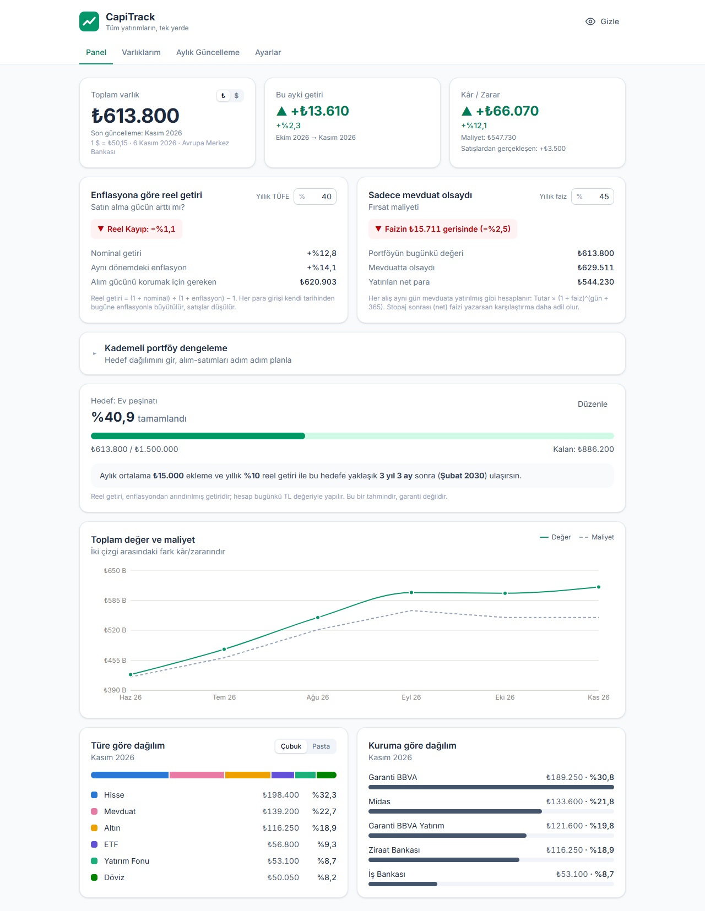
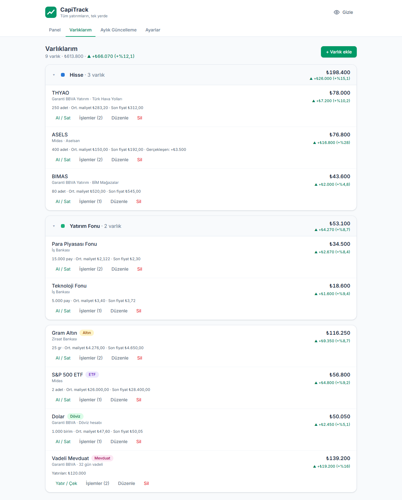
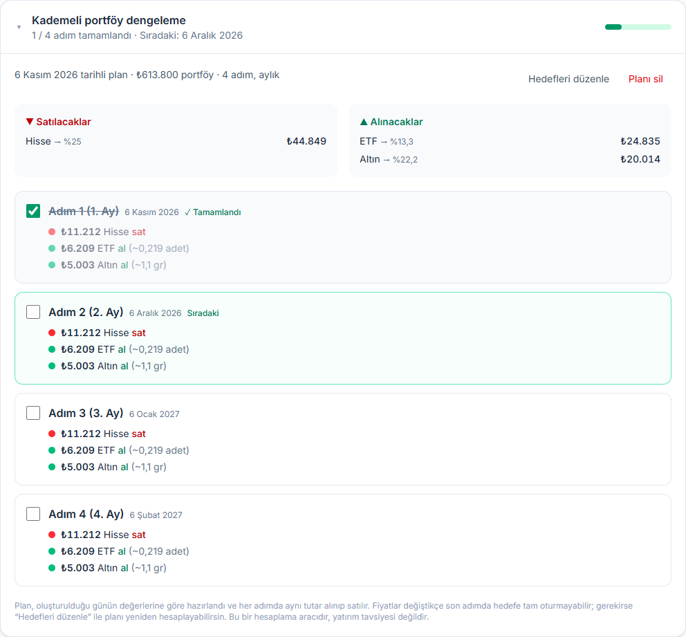
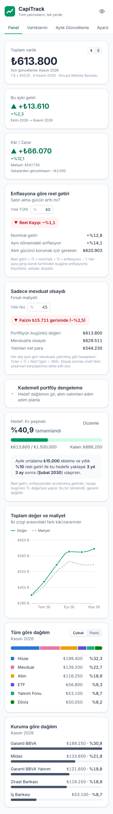

# CapiTrack

**Tüm yatırımların, tek yerde.**

İnsanların birikimleri çoğu zaman farklı bankalara ve aracı kurumlara dağılmış durumdadır: bir bankada altın hesabı, diğerinde hisse senetleri, bir başkasında vadeli mevduat… CapiTrack, bu yatırımların hepsini tek bir panelde toplar. Kullanıcı alış ve satışlarını kaydeder, her ay da birim fiyatları günceller; uygulama toplam varlığı, ağırlıklı ortalama maliyete göre gerçek kâr/zararı, zaman içindeki değişimi ve varlıkların türlere ve kurumlara göre dağılımını grafiklerle gösterir.

🔗 **Canlı site:** https://uturkmen24.github.io/capitrack/

🧪 **Örnek veriyle dene:** https://uturkmen24.github.io/capitrack/?demo



<details>
<summary>Varlıklarım: türe göre gruplu liste</summary>



</details>

<details>
<summary>Kademeli portföy dengeleme planı</summary>



</details>

<details>
<summary>Telefon görünümü</summary>



</details>

## Özellikler

- **Panel:** toplam varlık; *bu ayki getiri* (para ekleyip çıkarmanın etkisi ayıklanmış hâliyle); toplam *kâr / zarar* (değer − maliyet, ayrıca satışlardan gerçekleşen kâr). Grafiklerde aylara göre toplam değer ile yatırılan maliyet aynı çizgi grafikte gösterilir; türe göre ve kuruma göre dağılım da panelde yer alır.
- **Enflasyona göre reel getiri:** portföyün getirisi, girilen yıllık enflasyon (TÜFE) oranıyla Fisher denklemi kullanılarak karşılaştırılır. Sonuç `Reel Kazanç: +%X (Satın Alma Gücü Arttı)` ya da `Reel Kayıp: −%X` olarak gösterilir. Kartta nominal getiri, aynı dönemdeki enflasyon ve satın alma gücünü korumak için gereken değer de yazar. Varsayılan oran %40'tır; değiştirilen oran hatırlanır.
- **Sadece mevduat olsaydı (fırsat maliyeti):** her alış, kendi tarihinde mevduata yatırılmış gibi girilen yıllık faizle bugüne büyütülür. Portföyün bugünkü değeri bu sanal mevduatla karşılaştırılır: `Faize göre +₺X daha kârlı (+%Y Alfa)` ya da `Faizin ₺X gerisinde`. Varsayılan faiz %45'tir; değiştirilen oran hatırlanır.
- **Çubuk / Pasta görünümü:** türe göre dağılım, bölümlü çubuk veya halka (pasta) grafik olarak gösterilebilir. Pastada bir dilimin ya da listedeki bir türün üzerine gelince halkanın ortasında o türün tutarı ve payı görünür.
- **TL / Dolar:** toplam varlığa tıklayınca TL ile dolar arasında geçiş yapılır. Kur, ücretsiz bir servisten (Avrupa Merkez Bankası referans kuru) alınır ve 6 saat önbellekte tutulur; internet yoksa en son alınan kur kullanılır.
- **Gizlilik modu:** üst menüdeki göz ikonu, kafe veya kütüphane gibi ortak alanlarda tüm tutarları tek tıkla `₺***,**` olarak gizler. Değer giriş kutuları bulanıklaşır, kutuya tıklayınca netleşir. Tercih hatırlanır.
- **Kademeli portföy dengeleme:** Panel'de açılır bir karttır. Kullanıcı türler (Altın, Hisse…) ya da tek tek varlıklar (THYAO, PPF…) için hedef yüzdeler girer.
  - Form bugünkü paylarla dolu gelir; listeye henüz sahip olunmayan bir varlık da eklenebilir.
  - Toplam %100 değilse kırmızı uyarı çıkar ve *Hesapla* pasif kalır.
  - Adım sayısı (2, 3, 4, 6, 12) ve sıklık (haftalık / aylık) seçilir.
  - Sonuçta *Satılacaklar* ve *Alınacaklar* özetlenir, tarihli bir yol haritası çıkar: "Adım 1 (1. Hafta): ₺12.400 Altın al (~2,7 gr)". Birim fiyatı bilinen varlıklarda yaklaşık adet/gram karşılığı da yazar.
  - Her adım uygulandıkça işaretlenir; plan ve ilerleme tarayıcıda saklanır.
- **Hedef:** bir birikim hedefi (ör. ev peşinatı) belirlenir; portföyün hedefe oranı ilerleme çubuğuyla gösterilir. Aylık ekleme ve beklenen yıllık reel getiriyle, bileşik getiri hesabı yapılarak hedefe kaç ay sonra ulaşılacağı tahmin edilir.
- **Varlıklarım:** varlık ekleme, düzenleme ve silme. Her varlığın türü (Altın, Hisse, ETF, Yatırım Fonu, Döviz, Mevduat, Kripto, Diğer), kurumu ve notu tutulur. Varlık eklenirken ilk alış da aynı formda girilebilir.
- **Türe göre gruplama:** aynı türden birden fazla varlık varsa (ör. THYAO, BIMAS, ASELS → *Hisse*) bunlar tek bir başlık altında, listenin en üstünde gösterilir. Grup başlığında toplam değer ve grubun kâr/zarar yüzdesi yazar; her varlığın kendi kâr/zararı da satırında görünür. Gruplar açılıp kapatılabilir ve bu tercih hatırlanır. Türünde tek olan varlıklar gruplanmaz; altta, adlarının yanında renkli tür etiketiyle listelenir. Aynı türden ikinci bir varlık eklenince (ör. gram altının yanına altın sertifikası) o tür kendiliğinden gruba dönüşür. Gruplama hem *Varlıklarım* hem *Aylık Güncelleme* ekranında vardır.
- **Alış / satış işlemleri:** her varlık için tarih, adet ve birim fiyatla alış veya satış kaydedilir. Mevduat gibi tutarla takip edilen varlıklarda bunun yerine *Yatır / Çek* kullanılır. Elde olandan fazla satış yapılamaz. Satış formu, kaydetmeden önce tahmini gerçekleşen kâr/zararı gösterir. Her varlığın işlem geçmişi listelenir ve yanlış girilen işlem silinebilir.
- **Ağırlıklı ortalama maliyet:** kâr/zarar, bankaların kullandığı ağırlıklı ortalama maliyet yöntemiyle hesaplanır (ayrıntısı aşağıda). Yeni alış yapmak kâr, satış yapmak zarar gibi görünmez.
- **Aylık Güncelleme:** bir ay seçilir ve tüm varlıkların o ayki **birim fiyatı** (gram fiyatı, hisse fiyatı, kur…) tek ekranda girilir. Değer `adet × fiyat` olarak anlık hesaplanır. Mevduatta doğrudan bakiye yazılır. Alanlar son bilinen fiyatla hazır gelir. Ay toplamı ve para girişi/çıkışı ayıklanmış aylık getiri, formun altında görünür.
- **Son bilinen fiyat kuralı:** bir ay için fiyatı girilmeyen varlık, en son bilinen fiyatıyla (yoksa son işlem fiyatıyla) değerlenir. Tamamı satılan varlık toplamdan ve dağılımlardan düşer.
- **Ayarlar:** verinin JSON dosyası olarak yedeklenmesi, yedekten doğrulamalı geri yükleme, örnek veri yükleme ve tüm verileri silme.
- **Excel'e aktarma:** veriler biçimlendirilmiş bir `.xlsx` dosyası olarak indirilir. Dosyada beş sayfa bulunur:
  - *Varlıklar:* türe göre gruplu; miktar, ortalama maliyet, son fiyat, değer, kâr/zarar ve gerçekleşen kâr/zarar. Her türün formüllü ara toplamı ve genel toplamı vardır.
  - *Aylık Tablo:* varlık × ay değerleri, formüllü toplam satırıyla.
  - *İşlemler:* tüm alış/satışların filtrelenebilir listesi.
  - *Aylık Fiyatlar:* girilen birim fiyatlar.
  - *Dağılım:* son ayın türe ve kuruma göre payları.
- **Türkçe sayı girişi:** `45.000`, `45000,50` veya `1.250.000 ₺` yazımlarının hepsi doğru okunur.
- Telefon ve masaüstü uyumlu arayüz.

## Kullanılan teknolojiler

| Teknoloji | Kullanım amacı |
|---|---|
| [React](https://react.dev) 19 | Arayüz bileşenleri |
| [Vite](https://vite.dev) 8 | Geliştirme sunucusu ve derleme |
| [Tailwind CSS](https://tailwindcss.com) 4 | Stil |
| [Recharts](https://recharts.org) 3 | Çizgi ve pasta grafik |
| [ExcelJS](https://github.com/exceljs/exceljs) 4 | Excel (.xlsx) dosyası üretimi; sadece indirme butonuna basılınca yüklenir |
| [Frankfurter](https://frankfurter.dev) / [ExchangeRate-API](https://www.exchangerate-api.com) | Dolar/TL kuru (ücretsiz, API anahtarı gerektirmez) |
| LocalStorage | Verinin ve tercihlerin tarayıcıda saklanması (sunucu / veritabanı yok) |
| GitHub Actions + GitHub Pages | Her push'ta otomatik derleme ve yayın |

## Kurulum

Gereksinimler: [Node.js](https://nodejs.org) 20.19 veya üzeri ve [Git](https://git-scm.com).

```bash
git clone https://github.com/uturkmen24/capitrack.git
cd capitrack
npm install
npm run dev
```

Ardından tarayıcıda `http://localhost:5173` adresini aç.

| Komut | Ne yapar |
|---|---|
| `npm run dev` | Geliştirme sunucusunu başlatır; kod değiştikçe sayfa kendini yeniler |
| `npm run build` | Yayına hazır dosyaları `dist/` klasörüne üretir |
| `npm run preview` | Derlenmiş siteyi yerelde önizler |
| `npm run lint` | Kodu olası hatalara karşı denetler (oxlint) |

> **Not:** `package.json` içindeki komutlar Vite'ı `node node_modules/vite/bin/vite.js` şeklinde doğrudan çağırır. Windows'ta klasör yolunda noktalı virgül (`;`) bulunduğunda `vite` komutu bulunamadığı için bu yol tercih edildi; diğer sistemlerde de aynı şekilde çalışır.

## Proje yapısı

```
src/
├── App.jsx                 Üst menü ve sekmeler
├── pages/
│   ├── Dashboard.jsx       Panel: özet kartları ve grafikler
│   ├── Assets.jsx          Varlıklarım
│   ├── MonthlyUpdate.jsx   Aylık Güncelleme
│   └── Settings.jsx        Ayarlar: yedekleme, Excel, örnek veri, sıfırlama
├── components/
│   ├── TotalTile.jsx       Toplam varlık kartı (TL / Dolar geçişi)
│   ├── BenchmarkCards.jsx  Reel getiri ve "sadece mevduat olsaydı" kartları
│   ├── RebalancePlanner.jsx Kademeli portföy dengeleme: hedef formu ve adım adım plan
│   ├── GoalCard.jsx        Hedef kartı ve hedef formu
│   ├── TypeDistribution.jsx Türe göre dağılım (çubuk / pasta)
│   ├── AssetGroup.jsx      Açılıp kapanan tür grubu (toplam değer ve kâr/zarar)
│   ├── AssetForm.jsx       Varlık ekleme / düzenleme formu (isteğe bağlı ilk alışla)
│   ├── TransactionForm.jsx Alış / satış (mevduatta yatır / çek) formu
│   ├── TransactionList.jsx Bir varlığın işlem geçmişi
│   ├── TradeFields.jsx     Tarih, adet ve fiyat alanları
│   ├── ProfitLoss.jsx      ▲ / ▼ işaretli kâr/zarar yazısı
│   ├── SuggestInput.jsx    Öneri listeli metin kutusu (kurum alanı)
│   └── TypeBadge.jsx       Renkli tür rozeti
└── lib/
    ├── usePortfolio.js     Tüm verinin tutulduğu ve değiştirildiği yer
    ├── storage.js          LocalStorage okuma/yazma, yedek doğrulama, eski sürüm verisinin yedeklenmesi
    ├── analytics.js        Ağırlıklı ortalama maliyet motoru, aylık toplamlar, dağılım, işlem kontrolü
    ├── trade.js            Alış / satış formunun okunması ve kontrolü
    ├── goal.js             Bileşik getiri ve hedefe ulaşma süresi hesabı
    ├── benchmark.js        Para akışlarının enflasyon / mevduat faiziyle büyütülmesi, Fisher denklemi
    ├── rebalance.js        Hedef yüzdelere göre alım-satım tutarları, adımlara bölme, adım tarihleri
    ├── fx.js               Dolar/TL kurunun alınması ve önbelleklenmesi
    ├── exportExcel.js      Excel dosyasının oluşturulması
    ├── prefs.js            Tercihlerin hatırlanması (gizlilik, para birimi, görünüm, enflasyon ve faiz oranı)
    ├── format.js           Para, yüzde, tarih biçimleri, gizlilik maskesi, Türkçe sayı okuma
    ├── constants.js        Yatırım türleri, renkleri, birimleri ve gruplama
    └── demoData.js         Örnek portföy
```

## Veri modeli

Tüm veri tarayıcıda `capitrack:data` anahtarı altında tek bir JSON nesnesi olarak saklanır:

```json
{
  "version": 2,
  "assets": [
    { "id": "a1", "name": "THYAO", "type": "hisse", "institution": "Garanti BBVA", "note": "" }
  ],
  "transactions": [
    { "id": "t1", "assetId": "a1", "date": "2026-06-10", "kind": "buy", "quantity": 200, "price": 280 },
    { "id": "t2", "assetId": "a1", "date": "2026-08-14", "kind": "buy", "quantity": 50, "price": 296 }
  ],
  "prices": {
    "2026-10": { "a1": 305.5 },
    "2026-11": { "a1": 312.25 }
  },
  "goal": { "name": "Ev peşinatı", "target": 1000000, "monthly": 5000, "annualReturn": 0.1 }
}
```

- **assets:** kullanıcının sahip olduğu yatırımlar.
- **transactions:** alış (`buy`) ve satış (`sell`) işlemleri. Mevduat ve *Diğer* gibi tutarla takip edilen varlıklarda `quantity` yatırılan/çekilen tutardır, `price` 1'dir.
- **prices:** her ay için her varlığın ay sonu birim fiyatı (mevduatta o ayın bakiyesi). Ay anahtarı `YYYY-AA` biçimindedir.
- **goal:** birikim hedefi (tutar, aylık ekleme, yıllık reel getiri oranı) ya da hedef yoksa `null`.

Miktar, maliyet ve değer veride saklanmaz; her açılışta işlemlerden ve fiyatlardan yeniden hesaplanır. Böylece bir işlem silindiğinde ya da düzeltildiğinde tüm geçmiş kendiliğinden doğru kalır.

Gizlilik modu, para birimi, grafik görünümü, kapalı gruplar, enflasyon ve mevduat faizi oranı, dengeleme planı ve işaretlenen adımlar gibi tercihler portföy verisinden ayrı anahtarlarda (`capitrack:privacy` vb.) tutulur ve yedeğe dahil edilmez.

> **Sürüm geçişi:** İlk sürüm (`version: 1`) her ay için sadece toplam değer tutuyordu; bu bilgiden adet ve maliyet çıkarılamadığı için eski veri yeni modele çevrilmez. Uygulama eski veriyi `capitrack:data:v1-yedek` anahtarına yedekleyip boş başlar.

### Ağırlıklı ortalama maliyet

Her varlık için işlemler tarih sırasıyla işlenir:

| İşlem | Miktar | Toplam maliyet | Ortalama maliyet | Gerçekleşen K/Z |
|---|---|---|---|---|
| **Alış** `q` adet, `p` fiyattan | `+ q` | `+ q·p` | yeniden hesaplanır: maliyet ÷ miktar | değişmez |
| **Satış** `q` adet, `p` fiyattan | `− q` | `− q·ort` | **değişmez** | `+ (p − ort)·q` |

- **Değer** = miktar × son bilinen fiyat, **kâr/zarar** = değer − kalan maliyet.
- **Örnek:** 200 THYAO ₺280'den, sonra 50 adet ₺296'dan alınırsa ortalama maliyet `(56.000 + 14.800) / 250 = ₺283,20` olur. 50 adet ₺320'den satılırsa gerçekleşen kâr `(320 − 283,20) × 50 = +₺1.840` olur, kalan 200 adetin ortalama maliyeti ₺283,20 olarak kalır.
- **Tutarla takip edilen varlıklarda** (mevduat): yatırılan para maliyete eklenir. Para çekilince maliyet, çekilen tutarın bakiyeye oranında azalır.
- **Aylık getiri** = (bu ayın değeri − geçen ayın değeri) − o ayki net para girişi. Böylece ay içinde yeni alış yapmak getiri gibi, satış yapmak da kayıp gibi görünmez.

### Hedef hesabı

Hedefe ulaşma süresi, her ay birikimin getiri kadar büyüdüğü ve üstüne aylık ekleme yapıldığı varsayımıyla hesaplanır:

```
FV(n) = P·(1+r)ⁿ + C·((1+r)ⁿ − 1) / r        →        n = ln((H·r + C) / (P·r + C)) / ln(1+r)
```

`P` bugünkü portföy, `C` aylık ekleme, `H` hedef ve `r` aylık getiri oranıdır. Yıllık oran aylığa bileşik olarak çevrilir: `r = (1 + yıllık)^(1/12) − 1` (yıllık %10 → aylık yaklaşık %0,797).

### Reel getiri ve mevduat karşılaştırması

İki kart da aynı yöntemi kullanır: her para girişi (alış, mevduata yatırma) ve çıkışı (satış, çekme) kendi tarihinden bugüne yıllık oranla bileşik büyütülür. Girişler artı, çıkışlar eksi sayılır.

```
Büyütülmüş tutar = Σ Tutar · (1 + oran)^(gün / 365)
```

- **Sadece mevduat olsaydı:** oran olarak mevduat faizi kullanılır. Çıkan toplam, aynı para aynı tarihlerde mevduata yatırılsaydı bugün ulaşacağı değerdir. Fark = portföy değeri − sanal mevduat; alfa = portföy ÷ sanal mevduat − 1. Satışlar mevduattan para çekmek gibi düşülür; böylece satış yapmak portföyü haksız yere faizin gerisinde göstermez.
- **Reel getiri (Fisher):** `reel = (1 + r) / (1 + i) − 1`. Burada `r` portföyün yatırılan net paraya göre nominal getirisidir. `i` ise yıllık enflasyon değil, aynı para akışlarının yatırıldıkları süre boyunca gördüğü enflasyondur (yukarıdaki formül, oran olarak enflasyonla uygulanır). Portföy bir yıldan kısa süredir varsa yıllık oranı doğrudan kullanmak dönemleri uyuşmaz hâle getirir. Örnek: 6 ay önce yatırılan para için yıllık %40 enflasyon, dönem enflasyonu olarak yaklaşık %18'e karşılık gelir.

Girilen faiz yıllık bileşik oran olarak kabul edilir. Bankaların ilan ettiği oran genelde basit faizdir ve stopaj kesilir; daha adil bir karşılaştırma için net oran yazılmalıdır.

### Kademeli dengeleme hesabı

```
Hedef = Toplam portföy × Hedef yüzde / 100
Delta = Hedef − Bugünkü değer          (Delta < 0 → satılacak, Delta > 0 → alınacak)
Adım  = |Delta| / N                    (her adımda aynı tutar)
```

- Hedef yüzdeler toplamı %100 olduğu için satılanların toplamı alınanlarınkine eşittir; plan dışarıdan para gerektirmez. Her adımda önce satışlar, sonra alışlar yazılır.
- Form bugünkü paylarla doldurulurken paylar %0,1'e yuvarlanır. Toplamın tam %100 olması için yuvarlama artığı, küsuratı en büyük olanlara dağıtılır (en büyük kalan yöntemi).
- Portföyün binde birinden küçük farklar işlem sayılmaz. Bu, dokunulmayan satırlardaki yuvarlama gürültüsünü (ör. "₺40 ETF sat") eler. Elenen farklar alış ve satış toplamını birkaç yüz lira saptırabileceği için büyük taraf küçük tarafa eşitlenir; plan her zaman nakit-nötr kalır.
- Adet/gram karşılığı = adım tutarı ÷ son birim fiyat. Türe göre kırılımda yalnızca türde tek varlık varsa gösterilir (birden fazla hissenin ortak bir fiyatı yoktur).
- Plan, oluşturulduğu günün değerleriyle sabittir. Fiyatlar değiştikçe hedefe tam oturmayabilir; plan istenirse yeniden hesaplanır.

Veri sadece kullanıldığı tarayıcıda durur. Başka bir cihaza taşımak veya kaybetmemek için **Ayarlar → Yedeği indir** kullanılır.

## Yapay zekanın kullanımı

Proje, VS Code içinde **Claude Code** eklentisiyle (model: Claude Opus 5.5) geliştirildi. Kodun tamamı yapay zekaya yazdırıldı. Proje sahibi fikri, gereksinimleri ve kararları belirledi, her aşamayı tarayıcıda test etti ve bulduğu hataları bildirdi. Yapay zekadan her adımda neyi neden yaptığını açıklaması istendi.

| Aşama | Yapay zeka nasıl kullanıldı |
|---|---|
| **Fikir** | Gemini ile proje fikirleri tartışıldı. "Yatırım ve portföy takipçisi" fikri seçildi ve kişisel ihtiyaca göre şekillendirildi. |
| **Planlama** | Claude'a proje yönergesi ve fikir verilerek bir yol haritası istendi. Teknoloji seçimi (React + Vite, Tailwind, Recharts) ve aşamalar birlikte planlandı. |
| **Kurulum** | Claude, Vite projesini oluşturdu, Tailwind ve Recharts'ı kurdu, Git deposunu başlattı ve GitHub Pages için otomatik yayın iş akışını yazdı. |
| **Geliştirme** | Bileşenler aşama aşama üretildi: varlık yönetimi → aylık güncelleme → panel ve grafikler → yedekleme ve örnek veri. "Son bilinen değer" kuralı ve dağılım için bölümlü çubuk kullanımı gibi tasarım kararları gerekçeleriyle önerildi ve onaylandı. Grafik renkleri renk körlüğü testinden geçirildi. |
| **Yeni özellikler** | Temel uygulama bittikten sonra proje sahibinin istediği özellikler eklendi: çubuk / pasta görünüm seçici, TL / Dolar geçişi, gizlilik modu, Excel'e aktarma ve bileşik getirili hedef hesabı. Kur servisleri önceden test edilip tarayıcıdan erişime izin verdikleri doğrulandı. Hedef formülü, hedefe ulaşılan ay ile bir önceki ayın birikimi karşılaştırılarak kontrol edildi. Ardından aynı türdeki varlıkların gruplanması ve ağırlıklı ortalama maliyet sistemine geçildi. Bu değişiklikte veri modeli "aylık toplam değer"den "işlemler + aylık birim fiyat"a çevrildi. Eski veriyi dönüştürmek ile sıfırdan başlamak arasındaki seçim ve aylık girişin birim fiyatla mı toplam değerle mi yapılacağı, artıları ve eksileriyle proje sahibine soruldu; kararları proje sahibi verdi. Proje sahibinin hazırladığı ayrıntılı istekle "Benchmark & Fırsat Maliyeti" kartları eklendi. Claude, istekteki Fisher formülünde portföyün toplam getirisi ile yıllık enflasyonun farklı dönemlere ait olduğunu fark etti; enflasyonu da para akışlarının tarihlerine göre dönemleştirerek düzeltti. Satışların mevduattan para çekmek gibi düşülmesini de ekledi. Canlı fiyat çekme fikri için ücretsiz fiyat kaynakları tek tek denendi: döviz, kripto ve altın kaynakları tarayıcıdan erişime izin veriyor; BIST hisseleri ve TEFAS fonları ise CORS engeline takılıyor. Bu analiz proje sahibine sunuldu. Yine proje sahibinin ayrıntılı isteğiyle "Kademeli Portföy Dengeleme" modülü eklendi. Claude, isteğe birkaç ekleme önerip uyguladı: formun bugünkü paylarla dolu gelmesi (unutulan bir kalemin yanlışlıkla %0 olup tamamen satılmaması için), türe göre / varlığa göre kırılım seçimi ve mevduatta "al/sat" yerine "yatır/çek" yazılması. |
| **Hata ayıklama** | Klasör adındaki `;` yüzünden `vite` komutunun bulunamaması teşhis edilip çözüldü. Kullanıcının bildirdiği "kurum öneri listesinin yanlış yerde açılması" hatası, tarayıcının `<datalist>` özelliğinin Windows ekran ölçeklendirmesindeki sorununa bağlanıp kendi bileşenle değiştirildi. Zaman aşımına uğrayan GitHub Pages yayını, action sürümleri güncellenerek düzeltildi. Ekran görüntüleri incelenerek animasyon, yüzde biçimi ve eksen etiketi sorunları bulundu ve giderildi. Kullanıcının bildirdiği "pasta grafikte yazıların üst üste binmesi" sorunu, ipucu kutusu yerine halkanın ortasında bilgi gösterilerek; "grafiğe tıklayınca çıkan çerçeve" sorunu ise fare tıklamasında odak çerçevesi gizlenip klavye odağında korunarak çözüldü. Telefonda Aylık Güncelleme satırlarında uzun varlık adının giriş kutusuyla üst üste binmesi, satır esnek ızgaraya çevrilerek giderildi. |
| **Doğrulama** | Üretilen kod her aşamada derlendi ve linter'dan geçirildi. Sayı okuma, aylık toplam, yedek doğrulama ve hedef hesabı fonksiyonları örnek verilerle test edildi. Ortalama maliyet ve gerçekleşen kâr hesapları elle hesaplanan örneklerle (ör. THYAO ₺283,20 / +₺1.840) karşılaştırıldı. Fazla satışın engellenmesi ve eski sürüm verisinin yedeklenmesi de otomatik tarayıcı testine eklendi. Reel getiri ve mevduat hesapları elle sağlanabilen örneklerle test edildi (ör. 1 yıl önce ₺100, bugün ₺150, %40 enflasyon → reel +%7,14; %45 faiz → mevduat ₺145). İki oran eşit girildiğinde iki kartın aynı tutarı verdiği de doğrulandı. Dengeleme motoru, istekteki örnekle (₺100.000 portföy, %40 PPF / %25 Altın / %25 SPY / %10 BIST) ve tarih hesaplarıyla (yıl geçişi, ay sonu) test edildi. Tarayıcı testinde çıktı elle toplanırken, yuvarlama artıkları yüzünden satış ve alış toplamlarının ₺252 farklı çıktığı fark edildi; nakit dengesi kuralı eklenerek düzeltildi. Arayüz, otomatik kontrol edilen bir tarayıcıda (Edge + Puppeteer) butonlara tıklanarak denendi; indirilen Excel dosyası hücre hücre okunup kontrol edildi. Proje sahibi her aşamayı tarayıcıda elle test etti. |
| **Dokümantasyon** | Bu README ve ekran görüntüleri Claude tarafından hazırlandı. |
